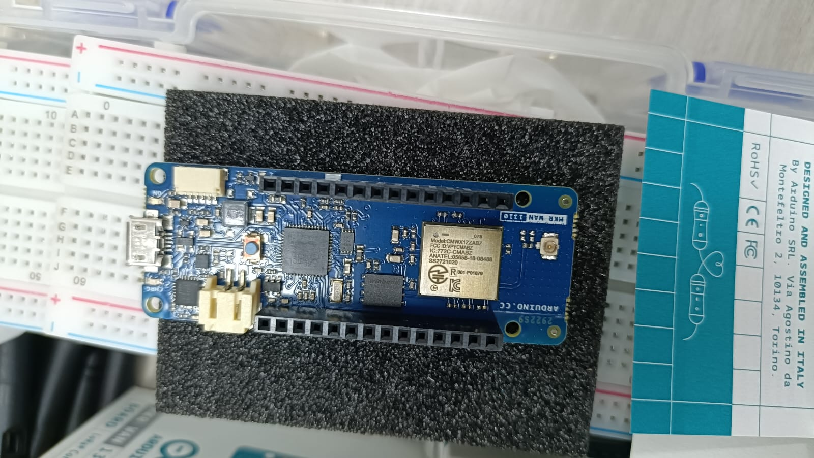
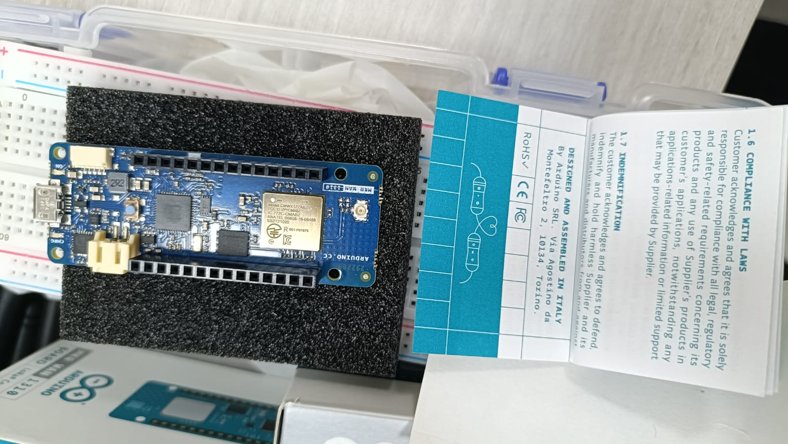
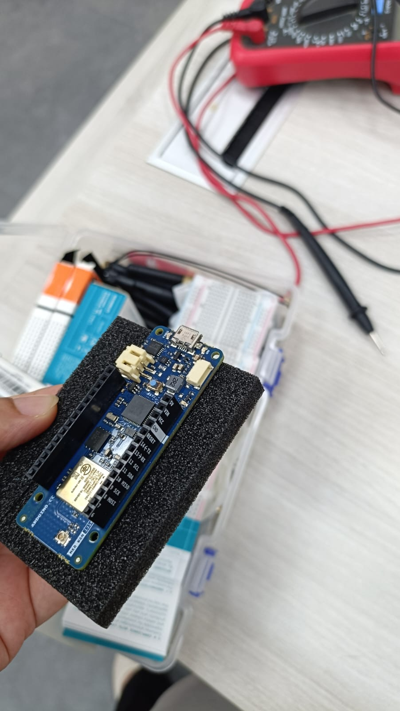
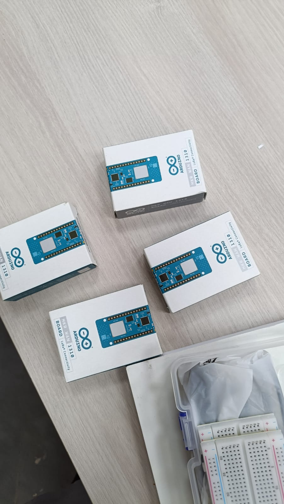

# Five-Robot Gazebo + RViz Demonstration

This directory archives the five-robot simulation and visualization used for a PhD demonstration. It contains a Gazebo Classic world, an RViz configuration, ROS 2 launch files, and a scripted robot explorer.

> **Scope:** This is a demonstration of five independent robot mapping sessions, not evidence that EMRMF map fusion or BACS/BACS+ communication scheduling was executed. Displaying maps together in RViz is not itself map fusion. No experimental results are modified by this documentation.

## Environment and dependencies

- Ubuntu 22.04 / ROS 2 Humble
- Gazebo Classic with ROS integration (`gazebo`, `gazebo_ros`, including `spawn_entity.py`)
- RViz 2 (`rviz2`)
- `slam_toolbox`, `robot_state_publisher`, ROS 2 launch and Python libraries
- Python 3 with `rclpy`, `geometry_msgs`, `sensor_msgs`, `nav_msgs`
- A sourced and built ROS workspace at `~/ros2_ws`

For a typical apt-based ROS 2 Humble installation, relevant packages include `ros-humble-gazebo-ros-pkgs`, `ros-humble-slam-toolbox`, `ros-humble-robot-state-publisher`, and `ros-humble-rviz2`. Installation and graphics support must be configured for the target machine.

## Files

| File | Purpose |
| --- | --- |
| `worlds/robotics_office_5rooms.world` | Gazebo environment |
| `rviz/five_robots.rviz` | Saved RViz visualization |
| `launch/five_robots_mapping.launch.py` | Five namespaced robot-state publishers and independent SLAM Toolbox nodes |
| `launch/two_robots_slam.launch.py` | Additional earlier SLAM configuration |
| `launch/three_new_robots.launch.py` | Additional earlier SLAM configuration |
| `launch/robotics_office_5rooms.launch.py` | **Separate two-robot** Gazebo launch, not the five-robot demo entry point |
| `scripts/demo.sh` | Original five-robot Gazebo/spawn/mapping/movement controller |
| `scripts/five_robot_explore.py` | Five-robot movement and obstacle-avoidance script |

## Important: local dependencies not yet archived

The original `scripts/demo.sh` uses **absolute paths under `$HOME/ros2_ws`**, not paths relative to this GitHub directory. It expects:

```text
~/ros2_ws/
├── install/setup.bash
├── final_demo/
│   ├── demo.sh
│   ├── five_robots_mapping.launch.py
│   └── five_robots.rviz
├── scripts/
│   └── five_robot_explore.py
└── worlds/
    ├── robotics_office_5rooms.world
    └── agilex_robots/
        ├── robot1_visual150.urdf
        ├── robot2_visual150.urdf
        ├── robot3_visual150.urdf
        ├── robot4_visual150.urdf
        └── robot5_visual150.urdf
```

**The five URDF files are not included in this archive.** They must be provided from the original local workspace before the five-robot demo can be reproduced. Other referenced mesh/plugin dependencies may also be needed. Do not assume a fresh clone is sufficient.

## Run the original five-robot demo (existing configured workstation)

The commands below reproduce the workflow **only if the original workspace paths and dependencies above are present**. Open a terminal:

```bash
source /opt/ros/humble/setup.bash
source ~/ros2_ws/install/setup.bash
cd ~/ros2_ws/final_demo
./demo.sh start
```

Wait until Gazebo has started and all five entities have spawned. Then:

```bash
./demo.sh mapping
```

To inspect the saved visualization, in a separate terminal:

```bash
source /opt/ros/humble/setup.bash
source ~/ros2_ws/install/setup.bash
rviz2 -d ~/ros2_ws/final_demo/five_robots.rviz
```

To start robot movement:

```bash
cd ~/ros2_ws/final_demo
./demo.sh move
```

To stop movement and subsequently stop the demo:

```bash
./demo.sh stop-move
./demo.sh stop
```

The original script writes logs to `~/ros2_ws/final_demo/logs/` and process IDs to `~/ros2_ws/final_demo/pids/`. The `start` command waits for the `/spawn_entity` service without a timeout; if Gazebo does not initialize, inspect `logs/gazebo.log` and interrupt the command as needed.

## Quick verification

```bash
ros2 node list
ros2 topic list | grep -E '^/robot[1-5]/(scan|odom|map|cmd_vel)$'
ros2 service list | grep /spawn_entity
```

Topic presence alone does not establish successful mapping. Verify that the five SLAM nodes receive laser scans and odometry and that the RViz displays update.

## Caveat about the separate world launch

`launch/robotics_office_5rooms.launch.py` defines only `limo01` and `limo02`. Its `WORLD` variable expects `robotics_office_5rooms.world` beside that Python file, whereas this archive stores the world in `worlds/`. That launch file is preserved unchanged for provenance and is **not** the documented five-robot start command.

## Reproducibility status

This archive preserves the original demonstration files without changing their behavior or the research data. Full clean-machine reproduction is **pending** archival of the five robot URDFs and validation of any external model, mesh, or plugin dependencies. No EMRMF/BACS performance claims should be inferred from this visualization alone.

## Real Hardware Evidence

Photographs of the physical wireless communication
boards and experimental hardware.

### Wireless Communication Boards





### Experimental Hardware Setup





**Note:** These photographs document physical hardware.
They do not independently verify LoRa communication,
ROS 2 integration, or BACS scheduling.
